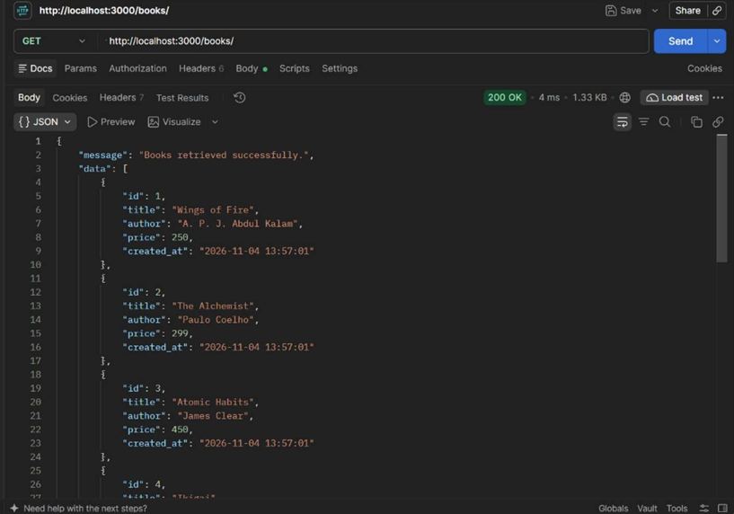
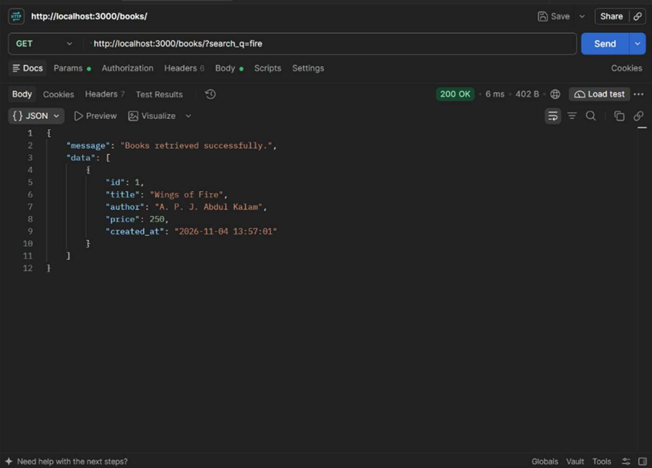
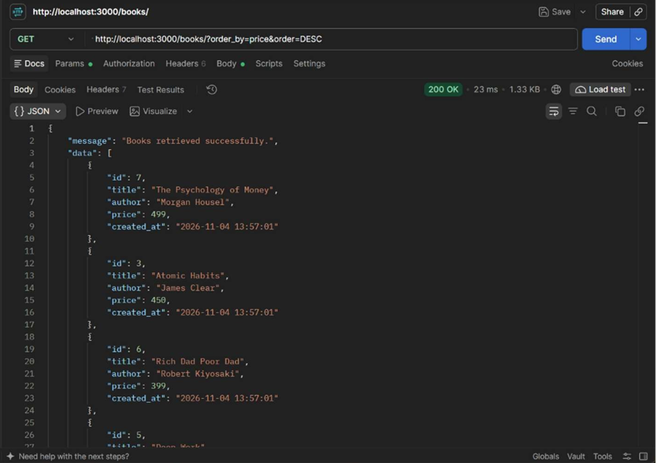
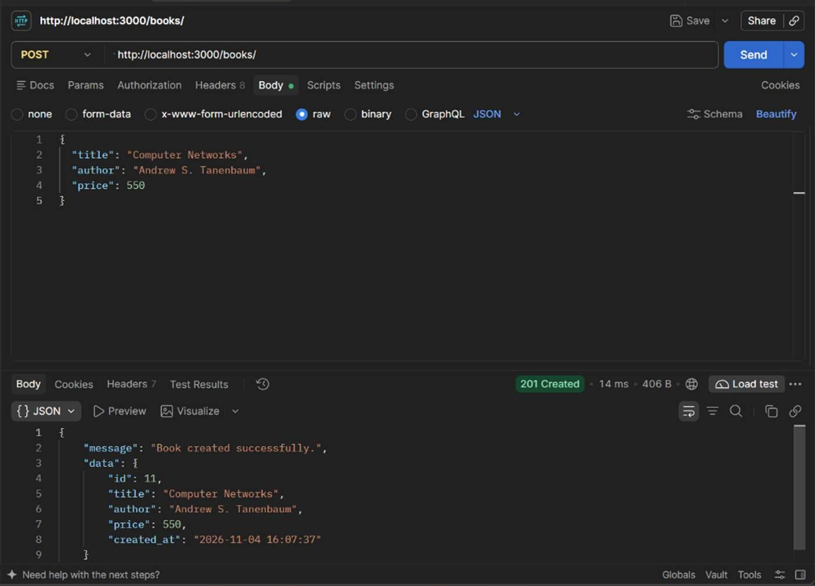
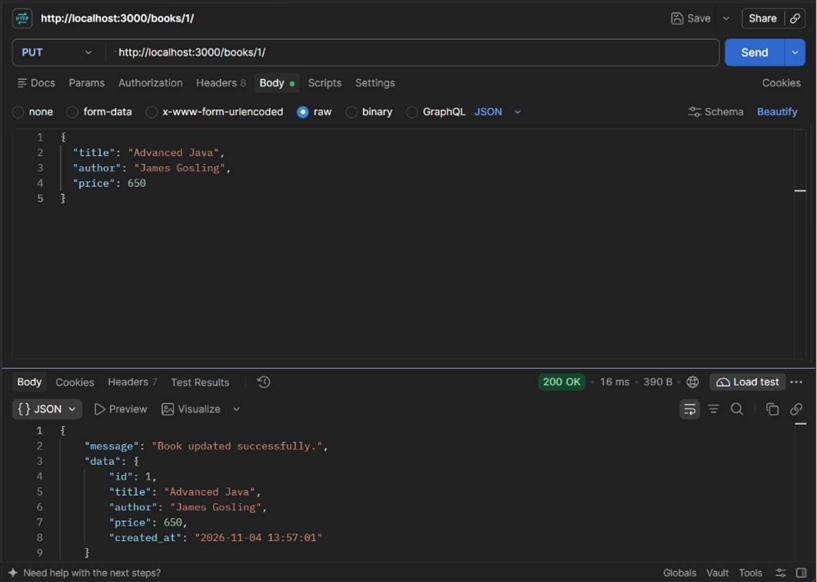
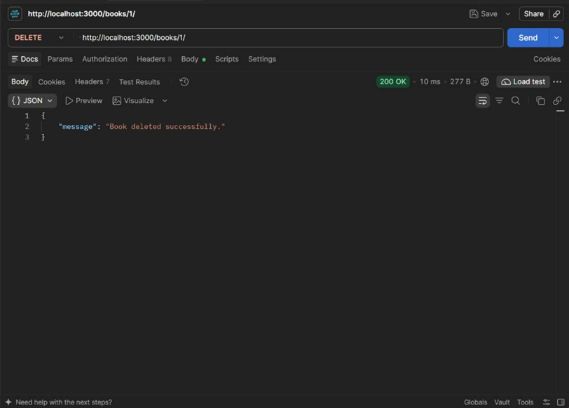
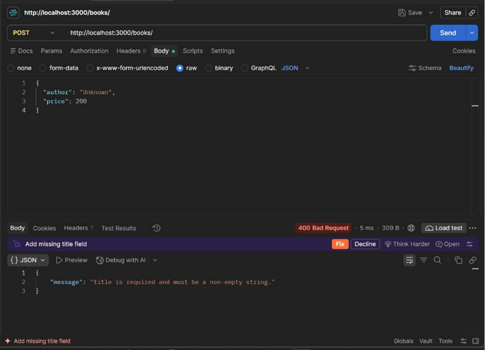
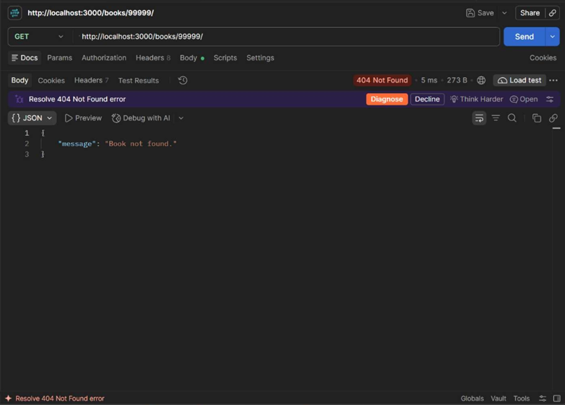

# Lab 3: REST API, query parameters, validation, debugging

**Name:** P.Harsha SIddhartha
**Registration number:** 252U1R9122 
**Section:** CSE-GENAI(2B)
**Live link:** https://backend-development-fundamentals-lab-3-z4m0.onrender.com


## How to run

Requirements: Node.js 22.5 or newer (the project uses Node's built-in SQLite module).

```bash
npm install
npm start
```

The API listens on port `3000` by default and creates `data/books.sqlite` automatically. Optional environment variables:

| Variable | Purpose | Default |
|---|---|---|
| `PORT` | HTTP port | `3000` |
| `DATABASE_PATH` | SQLite database file path | `data/books.sqlite` |

For development with automatic restarts, run `npm run dev`. Run the automated tests with `npm test`.

## Endpoints

| Method | Path | Description |
|---|---|---|
| GET | `/books` | List books; supports search, sorting, price filters, and pagination. |
| GET | `/books/:id` | Retrieve one book. |
| POST | `/books` | Create a book; requires non-empty `title`, non-empty `author`, and numeric non-negative `price`. |
| PUT | `/books/:id` | Replace a book's title, author, and price. |
| DELETE | `/books/:id` | Delete a book. |

### `GET /books` query parameters

| Parameter | Default | Description |
|---|---|---|
| `search_q` | No search filter | Case-insensitive partial match against the title. |
| `order_by` | `id` | One of `id`, `title`, `author`, `price`, or `created_at`. |
| `order` | `ASC` | Sort direction: `ASC` or `DESC`. |
| `limit` | `10` | Maximum number of results (1–100). |
| `offset` | `0` | Number of results to skip. |
| `min_price` | No lower bound | Inclusive minimum price. |
| `max_price` | No upper bound | Inclusive maximum price. |

Example:

```text
GET /books?search_q=clean&order_by=price&order=DESC&limit=5&offset=0&min_price=10&max_price=50
```

All responses are JSON. Errors have a consistent `{ "message": "..." }` shape. Invalid input returns `400`, missing books return `404`, create returns `201`, and successful reads, updates, and deletes return `200`.

## Postman tests

Import [`postman/Lab-03.postman_collection.json`](postman/Lab-03.postman_collection.json) into Postman and run the collection in order. It covers create/read/update/delete, query filters, invalid input, invalid sort columns, and missing records.

## Screenshots

### List books


### Search books


### Sort books


### Filter by price range


### Create a book


### Update a book


### Delete a book


### Validation error


### Missing record


## Debugging notes

- **`EADDRINUSE` (port conflict):** Start on another available port, for example `PORT=3001 npm start` (PowerShell: `$env:PORT=3001; npm start`).
- **Wrong import path:** The server imports `./app` and `./database` from `src/`; keep module names and paths in sync.
- **`no such table`:** `createDatabase()` creates and uses the `books` table when the server starts. Keep the table name consistent in schema and queries.
- **Missing `await`:** The automated HTTP tests await `fetch()` and response JSON before checking results.
- SQL values are passed using prepared-statement parameters. The only dynamic `ORDER BY` pieces are checked against fixed allowlists.

## Viva preparation

- A **path parameter** identifies a resource in the URL, such as `/books/12`; a **query parameter** filters or adjusts a collection request, such as `/books?limit=10`.
- A **stateless** API does not depend on server-side session state between requests; each request carries the information needed to process it.
- Use **400 Bad Request** for invalid input and **404 Not Found** when the requested record does not exist.

## Submission checklist

- Replace the name, registration number, and section placeholders.
- Add the deployed public URL or explain why deployment is not applicable.
- Capture and embed working-output screenshots in `screenshots/`.
- Publish the repository and submit its link.
